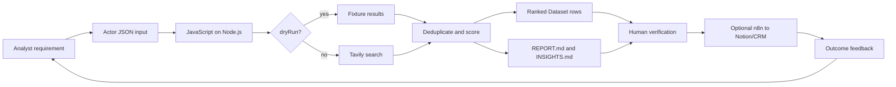

# Analyst 101: From Data to Intelligence with Code and Codex

This guide is for an analyst who understands data structures and programming ideas but does not yet work as a software developer. It explains what is in this repository, how the pieces turn data into an intelligence product, how to work safely with Codex, and what to keep or stop.

## 1. The short answer

Do **not** delete both project directions yet. Keep the JavaScript **Space Procurement Signal Radar** as the product candidate, and archive the Python experiments as learning/reference material. Run one small, time-boxed validation before investing in more technology.

The proposed project is not radar hardware. It borrows the radar metaphor:

1. **Scan** a defined information environment.
2. **Detect** possible signals in public sources.
3. **Classify and score** the signals using explicit rules.
4. **Rank** the resulting hypotheses.
5. **Verify** the evidence with a human.
6. **Act, learn, and rescan.**

The current narrow question is: **which DACH space companies might soon buy thermal-vacuum or related qualification services, and what public evidence supports that hypothesis?**

## 2. Data, information, and intelligence

These words should not be treated as synonyms.

| Layer | Meaning | Example in this project | Quality question |
| --- | --- | --- | --- |
| Data | A raw observation or record | A search result, URL, title, or text snippet | Is it authentic, current, and captured correctly? |
| Information | Data organized in context | A page links a company to a launch, grant, qualification test, or tender | What does the source actually say? |
| Signal | Information that may change a decision | A new mission deadline may imply near-term testing demand | Is the connection direct or inferred? |
| Intelligence | Assessed information made useful for a decision | A ranked, sourced lead with confidence and a next collection step | What decision does this support? |
| Action | A controlled response | Verify the source, identify the technical buyer, then request an interview | Did the action produce learning or value? |

An output is not intelligence merely because software or an LLM generated it. It becomes useful intelligence when it has a defined decision-maker, a decision deadline, traceable evidence, explicit uncertainty, alternatives, and a next action.

### The analyst loop

Use this repeatable loop:

```text
Decision -> intelligence requirement -> collection plan -> raw data
         -> validation -> structured information -> analysis
         -> sourced judgment -> action -> feedback -> revised requirement
```

For every conclusion, separate:

- **Fact:** directly supported by a cited source.
- **Inference:** a reasoned interpretation of one or more facts.
- **Assumption:** something not yet supported and needing collection.
- **Recommendation:** an action based on the facts, inferences, and constraints.

## 3. Repository tour: there are two project directions, not two repositories

This Git repository contains two generations of work.

### A. Current product candidate: JavaScript Apify Actor

Path: `actor-space-procurement-radar/`

The main program reads an Actor input, constructs search queries, gathers fixture or Tavily results, removes duplicate URLs, scores keyword-based signals, ranks leads, writes Apify Dataset and key-value-store outputs, and can send the result to n8n.

This is the best direction to continue because it has:

- a narrow user and decision;
- a runnable, credential-free dry run;
- an input contract and output contract;
- a live-data path;
- visible scoring rules;
- a deployment unit (the Actor).

Important limitation: the score measures **matched words**, not the probability that a company will buy. A high score is a prioritization aid, not proof of intent.

### B. Earlier experiments: Python analyst prototypes

Paths: `app/main.py` and `app/vix_learning_radar.py`

- `app/main.py` creates an Apify Actor Idea Radar report from seeded JSON.
- `app/vix_learning_radar.py` explores an educational VIX workflow using Cboe data, Apify crawling, and optional Tavily search.

These are useful examples of loading data, scoring records, and rendering Markdown, but they target different users and decisions. Do not develop them in parallel with the procurement product.

### C. Supporting material

| Path | Role | Treatment |
| --- | --- | --- |
| `data/space_procurement_business_ontology.json` | Machine-readable business concepts and relationships | Keep and improve with validated domain language |
| `data/sample_sources.json`, `data/vix_fixture.json` | Reproducible sample data | Keep as legacy/test fixtures |
| `docs/` | Canonical operating and evidence guidance | Keep; prefer this over scattered notes |
| `presentation/` | Pitch material | Update only after product evidence changes |
| `outputs/` | Experiments, generated artifacts, and templates | Archive; do not treat every file as current truth |

## 4. What every technology does

| Technology | Plain-English role | Why it exists here | What it does **not** do |
| --- | --- | --- | --- |
| Git | Versioned history of files | Makes experiments reversible and reviewable | Run or deploy the product |
| Git branch | An isolated line of work | Lets this learning/review work happen without changing the original branch | Duplicate the whole project folder |
| GitHub | Optional remote collaboration and review | Hosts a repo and pull requests when a remote is configured | Replace Git or validate analysis |
| JavaScript | Language of the current Actor | Implements collection, scoring, reporting, and delivery | Supply data by itself |
| Node.js | Runtime for JavaScript outside a browser | Executes `src/main.js`; this project requires Node 20+ | Provide a user interface automatically |
| npm / `package.json` | Dependency and command manifest | Installs the Apify SDK and defines `npm start` | Contain the application logic |
| JSON | Structured key/value data format | Defines Actor inputs, ontologies, and fixtures | Explain meaning without documentation/schema |
| Apify Actor | Packaged cloud job | Provides input handling, execution, logs, Dataset, and key-value storage | Guarantee source quality or analytical correctness |
| Tavily | Search/discovery API | Supplies candidate public web results in live mode | Verify claims or replace primary-source review |
| n8n | Workflow automation/orchestration | Optionally moves the result to another system | Improve a weak score or weak evidence |
| Notion / CRM | Human work queue and system of engagement | Stores leads, owners, dispositions, and follow-ups | Serve as the raw evidence archive by itself |
| Docker | Reproducible runtime packaging | Tells Apify how to build and run the Actor | Eliminate API credentials or operating costs |
| Markdown | Human-readable text format | Stores reports, runbooks, and presentations in Git | Enforce data types like JSON Schema does |
| Python | Language used by the legacy prototypes | Demonstrates analysis and report generation | Needed by the current JavaScript Actor |
| LLM / Codex | Reasoning and coding assistant | Helps inspect, explain, edit, test, and document the system | Supply ground truth, own decisions, or safely expose secrets |

### Architecture in one picture



## 5. Coding 101 using this project

### Files, values, and data structures

- A **file** stores code, configuration, documentation, or data.
- A **variable** gives a value a name, such as a search URL.
- A JavaScript **object** is a set of named fields, similar to a JSON record or a table row.
- An **array** is an ordered list, such as search results or leads.
- A **function** is a named transformation, such as `scoreResult(result, nicheNeed, region)`.
- A **condition** selects behavior, such as dry run versus live search.
- A **loop** repeats a step for every query or result.
- An `async` function waits for external work such as an HTTP API call.
- A **schema** defines allowed input fields and types.
- An **environment variable** supplies runtime configuration or a secret without putting it in source control.

### Read the program as a pipeline

Do not begin by reading every line. Trace one record:

1. Read `.actor/INPUT_SCHEMA.json` to learn the permitted inputs.
2. Find `Actor.getInput()` in `src/main.js` to see where input enters.
3. Follow query construction into either fixture data or `tavilySearch()`.
4. Follow a result through `dedupeByUrl()` and `scoreResult()`.
5. Find the sort and `maxLeads` limit.
6. Follow the final lead into `Actor.pushData()` and key-value-store writes.
7. Compare the generated fields with the documented output contract.

### Errors are evidence

When a command fails:

1. Copy the exact command and the first useful error message.
2. Identify whether it is syntax, dependency, credentials, network, input, or logic.
3. Change one thing at a time.
4. Run the smallest relevant check again.
5. Record environmental limitations instead of pretending the test passed.

## 6. Codex 101 for an analyst

Think of Codex as a fast collaborator operating on a repository, not as an authority. Give it a bounded outcome, context, constraints, and an acceptance test.

### A good request template

```text
Goal: Explain or change [specific outcome].
User/decision: This is for [person] deciding [decision].
Scope: Read/change only [paths].
Constraints: Do not [risk]; preserve [behavior]; never expose secrets.
Evidence: Distinguish facts, inferences, and assumptions; cite source files.
Acceptance: Run [commands] and show me the diff/results.
```

Example:

```text
Review the scoring logic in actor-space-procurement-radar/src/main.js for an
analyst. Do not change code yet. Map every input to every output, identify
false-positive risks, cite exact lines, and propose three tests.
```

### Safe working sequence

1. **Orient:** ask Codex to summarize the repo, current branch, and dirty files.
2. **Plan:** request a small plan before a broad change.
3. **Inspect:** ask it to cite existing code that supports its explanation.
4. **Change:** make one coherent change with explicit boundaries.
5. **Review:** inspect `git diff`; ask what could break and what remains assumed.
6. **Test:** run the smallest check, then the full available check.
7. **Commit:** save the verified unit of work with a descriptive message.
8. **Pull request:** use a PR to explain why, what changed, how it was tested, and remaining risks.

### Commands worth learning

Run these from the repository root unless the command starts with `cd`:

```bash
git status --short --branch          # current branch and uncommitted changes
git diff                             # inspect uncommitted edits
git log --oneline -5                 # recent history
git switch -c my_experiment          # create and enter a branch
git add path/to/file                 # stage an intentional file
git diff --cached                    # inspect exactly what will be committed
git commit -m "docs: explain workflow" # create a checkpoint

python app/main.py                   # run the older fixture-based report
cd actor-space-procurement-radar
npm start                            # run the Actor locally
```

Avoid putting API keys in prompts, code, Git commits, screenshots, or logs. Use environment variables and `.env` files that Git ignores; commit only `.env.example` placeholders.

### What Codex is actually doing

Codex works in a loop rather than by silently “understanding the whole project”:

```text
your instruction
    -> inspect available context and repository files
    -> form a working hypothesis and plan
    -> call tools (shell, file editing, tests, or configured integrations)
    -> read the tool result
    -> revise the hypothesis or files
    -> report the change, evidence, tests, and limitations
```

There are four important boundaries:

1. **Context is finite.** Codex sees the conversation, instructions supplied to it, and files/tool results it deliberately reads. A file existing in the repository does not mean it has been read.
2. **Tools define access.** A shell tool can inspect this repository. Outlook can be inspected only if a mail connector/tool is configured and authorized. Codex cannot infer inbox contents from an email address or repository.
3. **Generated text is probabilistic.** Explanations and code may sound confident while being incomplete. Tests, diffs, schemas, source citations, and human domain review turn suggestions into evidence.
4. **The working tree is shared state.** Tool calls can really edit or delete files and run programs. Git makes those operations inspectable and reversible, but only committed work is a durable checkpoint.

Codex does not normally “train on” this repository during a session. It reads selected material into working context, reasons over it, and uses tools. Repository edits do not change the underlying model. A future session must read the files again, which is why clear documentation and small commits matter.

### Instruction priority and why prompts sometimes surprise you

Codex follows higher-priority platform and repository instructions before an ordinary user request. It must also work within available permissions and tools. A strong request therefore says what outcome matters without prescribing a false fact or unsafe shortcut.

For analytical work, ask Codex to return this contract:

| Output | Required evidence |
| --- | --- |
| Repository fact | File and line citation |
| External fact | Direct source link and access/publication date when known |
| Inference | The facts and reasoning used |
| Code change | Diff, test command, and test result |
| Limitation | Missing access, missing data, or an untested path |

### How to review a Codex change instead of merely accepting it

Use four passes:

1. **Intent:** does the diff solve the requested decision or merely add plausible text/code?
2. **Correctness:** trace one normal input, one empty input, and one failure through the changed behavior.
3. **Evidence:** verify every factual claim and distinguish fixture output from live output.
4. **Operations:** check secrets, cost, logs, rollback, ownership, and whether another person can reproduce it.

Useful follow-up prompts are:

```text
Show only claims you verified directly and list everything still assumed.
Walk one record through the changed code with exact file/line references.
What is the strongest reason not to merge this change?
Which test would fail if your interpretation were wrong?
Compare the staged diff with my acceptance criteria item by item.
```

## 7. Fraunhofer connection: what is known and what is not

The repository currently contains one explicit Fraunhofer reference: the Fraunhofer HHI page on **space laser communications**. The Actor uses it as an ecosystem anchor and as one default search query. It is not documentation for an intelligence-analysis method.

The remembered article about “radar” and “intelligence” cannot be identified reliably from the repository alone. Do not cite the HHI laser-communications page as that article. Possible concepts to search for when the title, institute, date, or phrase becomes available include:

- technology radar;
- technology scouting;
- strategic foresight;
- competitive or market intelligence;
- early-warning systems;
- future or innovation intelligence.

Useful recovery queries:

```text
site:fraunhofer.de "technology radar" intelligence
site:fraunhofer.de "strategic intelligence" radar
site:fraunhofer.de technology scouting foresight
site:fraunhofer.de Marktintelligenz Technologieradar
```

Until the actual article is recovered, the honest statement is: **Fraunhofer is a domain source already used by the prototype; any methodological inspiration from a particular Fraunhofer article remains an unverified memory.** Add the recovered URL, title, publication date, relevant claim, and access date to the evidence ledger before using it in a pitch.

## 8. Keep, pivot, or drop: an evidence gate

### Recommendation now

| Item | Decision | Reason |
| --- | --- | --- |
| Space procurement Actor | **Continue for one validation sprint** | Narrowest link between a user, evidence, and action |
| Python VIX radar | **Archive** | Educational but a different audience and decision; financial context adds avoidable scope/risk |
| Python Actor Idea Radar | **Archive as a pattern** | Useful code example, not the current product |
| n8n and Notion integration | **Defer** | Automation before validated demand creates plumbing, not intelligence |
| More scoring features or AI | **Defer** | First learn whether users value the output and which signals predict action |

Archive means “clearly label and stop active investment,” not “delete history.” Git preserves files, but a short archive note prevents accidental confusion.

### A two-week validation sprint

1. Interview **five** potential users who sell a specific qualification service into DACH space organizations.
2. Ask each for one real territory or account-planning decision, its deadline, and their present workflow.
3. Manually create **ten** source-backed candidate briefs using the output contract.
4. Require users to label each brief: relevant/irrelevant, factually sound/unsound, and actionable/not actionable.
5. Track whether they perform the recommended verification or outreach step.
6. Record false positives, missing sources, time saved, and any willingness to pay or pilot.

### Decision rule after the sprint

- **Continue:** at least 3 of 5 users return for a second use, at least 60% of reviewed leads are judged relevant, and at least 2 users take a documented next action.
- **Pivot:** users value the evidence workflow but repeatedly ask for another niche, geography, signal, or output.
- **Drop/park:** fewer than 2 users have the problem, evidence cannot be verified economically, or nobody acts on otherwise accurate briefs.

These thresholds are proposed learning gates, not facts about market demand.

## 9. Minimum intelligence record for the next version

Before adding more automation, make every lead carry:

```json
{
  "entity": "Company name",
  "decision": "Why investigate this account now?",
  "claim": "Concise assessed judgment",
  "factEvidence": [
    {
      "url": "https://primary-source.example/item",
      "publisher": "Publisher",
      "publishedAt": "YYYY-MM-DD or unknown",
      "retrievedAt": "YYYY-MM-DD",
      "supports": "Exact fact supported by this source"
    }
  ],
  "inferences": ["Reasoning that connects facts to the possible need"],
  "assumptions": ["What still must be verified"],
  "confidence": "low | medium | high",
  "nextCollectionStep": "One action that could confirm or reject the hypothesis",
  "owner": "Analyst name",
  "status": "new | verifying | accepted | rejected",
  "outcome": "What happened after action"
}
```

This is more useful than adding an opaque “AI score.” It preserves provenance and creates feedback data for later improvements.

## 10. Your next three sessions

### Session 1: understand (60–90 minutes)

- Read this guide and `docs/SINGLE_SOURCE_OF_TRUTH.md`.
- Run the Python fixture example.
- Run the Actor in dry mode.
- Draw the pipeline from input to output in your own words.

### Session 2: challenge (60 minutes)

- Take the top three fixture leads.
- Label every statement fact, inference, or assumption.
- Explain why each score was awarded by reading the keyword checks.
- Write one false-positive example for each scoring category.

### Session 3: validate (90 minutes)

- Choose one specific seller persona.
- Write their decision and deadline.
- Collect three primary sources manually.
- Produce one intelligence record using the schema above.
- Ask a real user whether it changes their next action.

## 11. Definition of done for an analyst-built product

The next milestone is complete when:

- a target user and recurring decision are named;
- inputs, sources, transformation rules, and outputs are documented;
- every important claim links to evidence;
- inference and uncertainty are visible;
- dry-run behavior is reproducible;
- live mode fails clearly when credentials or sources fail;
- scoring has test cases, including false positives;
- one user action and its outcome can be recorded;
- the keep/pivot/drop gate is evaluated with actual observations.

The goal is not to become a full-time developer before starting. The goal is to make the analytical method explicit enough that code can repeat it, tests can challenge it, and a user can decide whether it is valuable.
