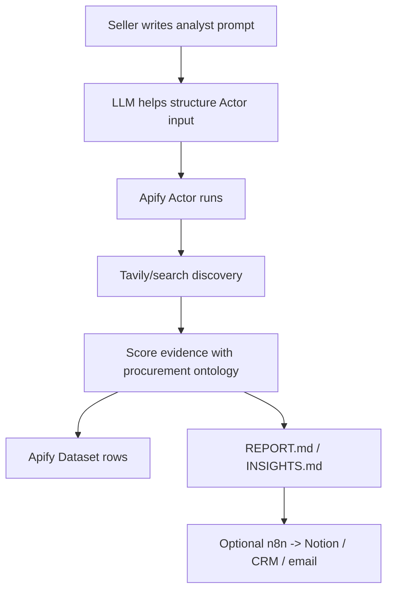
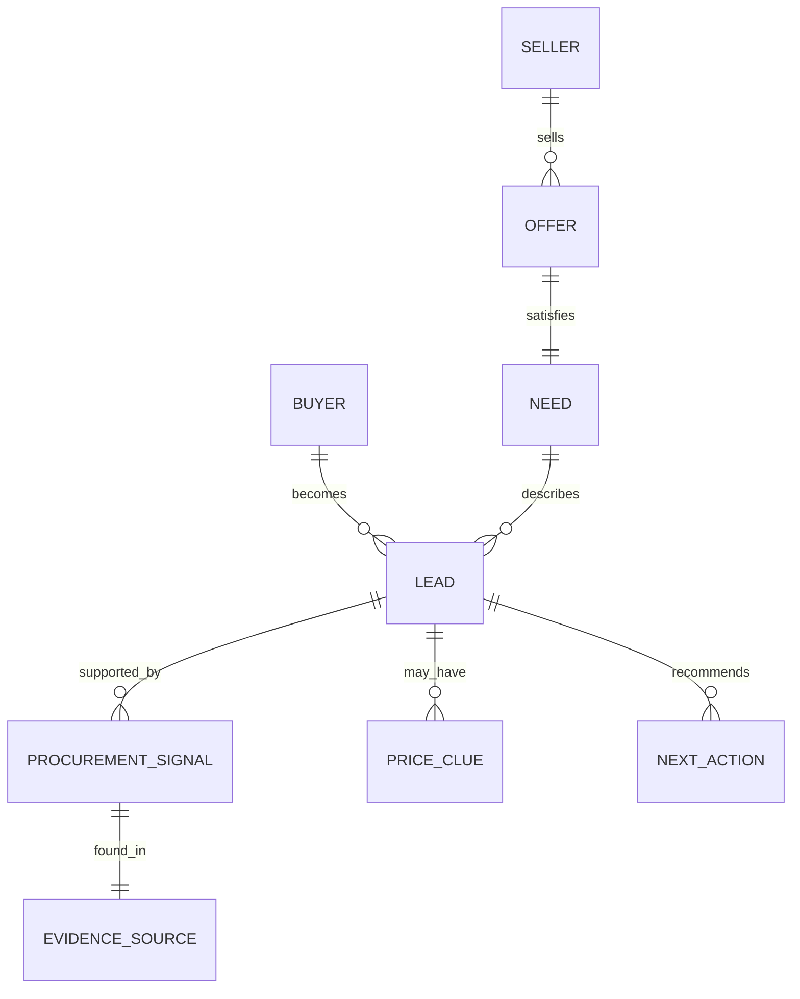

# Space Procurement Signal Radar - Single Source Of Truth

## Project Name

```text
Space Procurement Signal Radar
```

## One-Line Concept

An Apify Actor that acts like a forward deployed analyst for a niche seller: it takes a plain-language sales/procurement prompt, discovers public web evidence, scores prospective buyers, and prints a one-page lead brief.

## Hackathon Fit

| Requirement | How This Project Meets It |
| --- | --- |
| Working demo | Custom Apify Actor runs with dry-run fixture data and live Tavily mode |
| At least one Apify Actor | `actor-space-procurement-radar` |
| Uses live data | Tavily Search API in live mode; optional future Apify Website Content Crawler |
| Public repo/project link | This repo is prepared for GitHub |
| 2-minute demo | Use `presentation/space_radar_5_slide_live_pitch.md` |

## Core Workflow

```text
User prompt -> web/search discovery -> score evidence -> print insights -> save report
```



## Default Use Case

The first narrow use case is:

```text
Find 1-5 DACH space-tech companies likely to need thermal vacuum testing soon.
For each company, report score, evidence, source link, contact info if available,
and a short engagement email.
```

## Why This Is Useful

As a niche seller, the goal is not a generic list of companies.

The useful output answers:

```text
Who should I investigate first?
Why now?
What evidence supports it?
What is the price or budget clue?
What should I do next?
```

This is procurement decision intelligence, not just scraping.

## User Inputs

| Input | Example | Why It Matters |
| --- | --- | --- |
| `analystPrompt` | Find DACH space-tech companies likely to need thermal vacuum testing soon | Defines the analyst task |
| `nicheNeed` | thermal vacuum testing | Keeps the search specific |
| `region` | Germany DACH | Localizes the search |
| `maxLeads` | 5 | Keeps output usable |
| `dryRun` | true/false | Enables credential-free demo |
| `tavilyApiKey` | `tvly-...` | Enables live search |
| `n8nWebhookUrl` | webhook URL | Optional workflow handoff |

## Output Contract

Each lead row should include:

| Field | Meaning |
| --- | --- |
| `companyOrSource` | Company/source name |
| `region` | Geographic focus |
| `likelyNeed` | Product/service likely needed |
| `score` | 0-100 evidence score |
| `confidence` | Low / Medium / High |
| `urgencyReason` | Why the timing may matter |
| `priceBudgetClue` | Tender, grant, award, or proxy clue |
| `sellerAngle` | Suggested sales angle |
| `evidence` | Source-backed snippet |
| `sourceUrl` | Evidence URL |
| `matchedSignals` | Ontology categories that matched |

The Actor also writes:

```text
Apify Dataset rows
OUTPUT
REPORT.md
INSIGHTS.md
```

## Business Ontology



The machine-readable ontology lives at:

```text
data/space_procurement_business_ontology.json
```

## Scoring Model

| Signal | Points | Interpretation |
| --- | ---: | --- |
| Need fit | 25 | Company builds relevant hardware |
| Urgency | 20 | Launch, contract, prototype, tender, delivery |
| Dependency | 20 | TVAC, qualification, vibration, ECSS, cleanroom |
| Small-company fit | 15 | Startup/SME likely uses external suppliers |
| Price/budget clue | 10 | Tender, award, grant, funding, budget proxy |
| Contactability | 10 | Contact, supplier page, imprint, email |

## Technical Components

| Component | Role |
| --- | --- |
| Apify Actor | Runnable product and data store |
| JavaScript | Actor implementation |
| Tavily | Optional live search/discovery API |
| n8n | Optional local workflow handoff |
| Notion | Optional human-facing lead database |
| Markdown reports | Presentation and demo artifact |

## Repository Map

```text
actor-space-procurement-radar/   Custom Apify Actor source
data/                            Machine-readable ontology and fixtures
docs/                            Canonical repo/project docs
presentation/                    Presentation source files
outputs/                         Working notes, templates, generated artifacts
app/                             Earlier Python prototypes and legacy exploration
```

## Minimal Demo

Run the Actor in Apify with:

```json
{
  "analystPrompt": "Find DACH space-tech companies likely to need thermal vacuum testing soon. Focus on evidence, urgency, price or budget clues, and next action for a forward deployed analyst.",
  "nicheNeed": "thermal vacuum testing",
  "region": "Germany DACH",
  "maxLeads": 5,
  "dryRun": true
}
```

Show:

1. Actor input form.
2. Run log.
3. Dataset rows.
4. `REPORT.md` or `INSIGHTS.md`.

## Live Demo

Add a Tavily API key as an Apify secret/environment variable:

```text
TAVILY_API_KEY=tvly-your-key
```

Run:

```json
{
  "analystPrompt": "Find 1-5 DACH space-tech companies likely to need thermal vacuum testing soon. Report score, evidence, source link, contact info if available, and an engagement email.",
  "nicheNeed": "thermal vacuum testing",
  "region": "Germany DACH",
  "maxResultsPerQuery": 5,
  "maxLeads": 5,
  "searchDepth": "basic",
  "dryRun": false
}
```

## 2-Minute Pitch

```text
I built Space Procurement Signal Radar, a forward deployed analyst Actor for niche sellers.

A user gives it a plain-language prompt, like: find DACH space-tech companies likely to need thermal vacuum testing soon.

The Actor discovers web evidence, scores each result with a procurement ontology, and prints a short brief with ranked companies, evidence, price or budget clues, and a suggested next action.

Apify provides the runnable Actor and Dataset/report storage. Tavily can provide live search. n8n can route the result into Notion or a sales workflow.

The goal is not a generic scraped list. The goal is a ranked action list a seller can use today.
```

## Presentation Source

Use:

```text
presentation/space_radar_5_slide_live_pitch.md
presentation/space_radar_full_presentation.md
```

The 5-slide version is for the live hackathon pitch. The full version is the detailed story and architecture.

## Legacy Exploration

Earlier explorations are retained in `app/` and `outputs/`:

- VIX Learning Radar
- Apify Actor Idea Radar
- OSINT/proof-of-work context

They are not the current submission direction.

