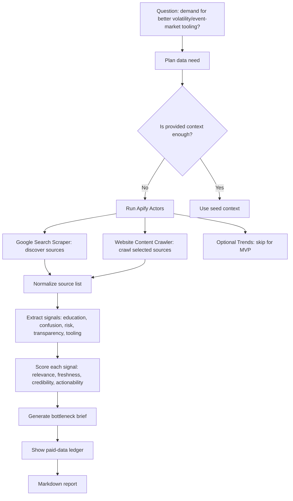

# Concrete MVP Build Card - Make The Abstract Flowchart Buildable

Date: 2026-06-20
Problem: The current idea is too abstract because "strategic brief" and "target question" can mean anything.

## 1. The Fix

Do not build a general strategy agent.

Build this:

**Bottleneck Radar: CBOE Market Structure Signal Agent**

One-line demo:

> "The agent pays for live web data to map public signals around a market-infrastructure question, scores the evidence, and produces a bottleneck brief plus paid-data ledger."

Why CBOE:

- It connects to your volatility / market structure interest.
- It is public, non-sensitive, and safer than defense.
- It is concrete enough for web search and crawling.
- It avoids job search entirely.
- It can later generalize to LATAM regulated infrastructure.

## 2. The Exact Demo Question

Use this exact question:

> "What public signals suggest there is demand for better retail-facing education, transparency, or tooling around volatility products and event-based markets?"

This is specific enough to search, but not financial advice.

## 3. The Exact Output

The agent outputs a Markdown report:

1. Executive answer
2. Evidence table
3. Top 3 bottleneck signals
4. Source-quality scores
5. Paid-data ledger
6. Recommended proof artifact
7. Caveats

Recommended proof artifact:

> "A volatility product explainer and risk-framing dashboard that separates education, market structure, and trading decision support, without recommending trades."

## 4. Your Flowchart Made Concrete



## 5. Use Only Two Actors For MVP

### Actor 1: Google Search Scraper

Purpose:

- Find candidate public sources.

Queries:

```text
CBOE volatility products retail education risk VIX options
CBOE event contracts retail investors education risk
volatility products retail investor confusion VIX options education
```

Expected output:

- URL
- title
- snippet
- rank

### Actor 2: Website Content Crawler

Purpose:

- Crawl selected official/credible pages and extract clean Markdown/text.

Start URLs:

- 2-5 URLs chosen from search results
- Prefer CBOE official education/product pages and credible public explainers

Expected output:

- URL
- title
- text or Markdown
- metadata

Note: Apify's Website Content Crawler is designed to crawl websites and extract text/Markdown for LLM/RAG use cases. Google Search Scraper is the discovery step.

## 6. Signal Types

Extract only these five signal types:

- `education_gap`: users need explanation or onboarding
- `risk_clarity_gap`: risk is hard to understand
- `product_complexity`: product mechanics are complex
- `tooling_gap`: existing tools do not answer the decision question
- `market_structure_signal`: public evidence of a broader infrastructure shift

This prevents the model from rambling.

## 7. Scoring Rubric

Each source gets 1-5:

- Relevance: does it answer the question?
- Freshness: is it current enough?
- Credibility: official/primary source or credible secondary?
- Actionability: does it imply something buildable?

Signal value:

```text
signal_value = relevance + freshness + credibility + actionability
```

Interpretation:

- 16-20: very useful
- 11-15: useful
- 6-10: weak
- 1-5: discard

## 8. The Buildable Data Shape

```json
{
  "question": "What public signals suggest demand for better retail-facing education, transparency, or tooling around volatility products and event-based markets?",
  "sources": [
    {
      "url": "https://example.com",
      "title": "Example title",
      "actor": "apify/website-content-crawler",
      "summary": "What the source says",
      "signals": [
        {
          "type": "education_gap",
          "text": "Specific signal from source",
          "relevance": 4,
          "freshness": 3,
          "credibility": 5,
          "actionability": 4,
          "signal_value": 16
        }
      ]
    }
  ],
  "ledger": [
    {
      "actor": "apify/google-search-scraper",
      "reason": "Discover public sources",
      "input": "CBOE volatility products retail education risk VIX options",
      "output": "10 search results",
      "cost_proxy": "Apify platform usage",
      "signal_value": 4
    }
  ]
}
```

## 9. What The Demo Actually Shows

The demo does **not** claim:

- "Here is what to trade."
- "Here is an investment recommendation."
- "Here is a complete market study."
- "Here is a Palantir-scale system."

The demo claims:

> "Here is a small agent that pays for public web data, extracts bottleneck signals, scores source value, and recommends a proof artifact."

That is enough.

## 10. If CBOE Still Feels Too Finance-Heavy

Use this even safer target:

**Apify Actor Idea Radar**

Question:

> "What public signals suggest builders need better ways to decide which Apify Actor is worth paying for?"

Sources:

- Apify Actor ideas documentation
- Apify Store
- Website Content Crawler page
- Google Search Scraper page

Output:

- Bottleneck: too many Actors, hard to choose, unclear source value
- Proof artifact: an Actor selection and ledger tool

This is probably the easiest hackathon option.

## 11. Recommended Decision

If you want maximum safety and easiest build:

> Build **Apify Actor Idea Radar**.

If you want it to connect to your longer-term founder direction:

> Build **CBOE Market Structure Signal Agent**.

My honest recommendation:

Start with **Apify Actor Idea Radar** for the hackathon. After the event, fork the same code into CBOE and LATAM procurement versions.

## 12. 90-Minute Build Plan

### 0-15 min

Create static input JSON with the question and 3 seed URLs.

### 15-35 min

Run Website Content Crawler manually or via API on those URLs.

### 35-55 min

Parse results into `sources.json`.

### 55-75 min

Run simple LLM or rules-based extraction:

- source summary
- signal type
- signal text
- scores

### 75-90 min

Generate Markdown report and ledger table.

## 13. 3-Hour Build Plan

### Hour 1

Manual Apify runs, save datasets, define source schema.

### Hour 2

Python script:

- load dataset JSON
- score sources
- generate evidence table

### Hour 3

Report generator:

- Markdown output
- Mermaid diagram
- pitch script

## 14. Pitch Script

> "At first this sounded like a strategy problem, which is too abstract. So I made it concrete: agents that pay need to decide what data is worth buying. This prototype uses Apify to discover and crawl public sources, then scores each source for relevance, freshness, credibility, and actionability. The output is not just a brief. It is a ledger: what the agent paid for, why, and whether it changed the decision."

## 15. Minimum Winning Demo

You only need:

- One question
- Three sources
- Two Actor runs or one Actor run plus provided context
- One evidence table
- One ledger
- One recommended proof artifact

If those five things are visible, the idea is buildable.

