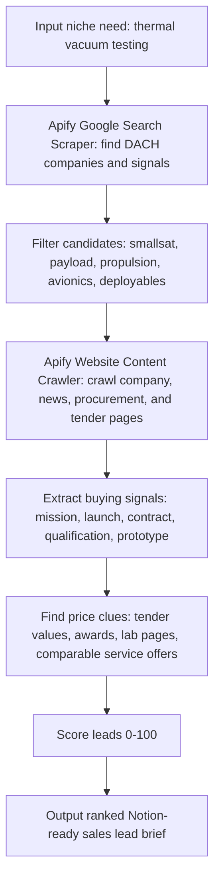

# Space Procurement Signal Radar - DACH Hackathon Notion Page

## Clear Direction

Build a procurement decision-intelligence agent for the DACH space-tech ecosystem.

The agent should not make a generic company list. It should find **specific procurement pressure**: small space-tech companies that appear likely to need a very specific thing soon, then explain the evidence, urgency, and price/budget clues.

Primary niche:

```text
Thermal vacuum testing services for small satellite, CubeSat, payload, propulsion, avionics, and deployable-hardware teams in Germany/DACH.
```

Why this is a home-game advantage:

- Germany/DACH has dense aerospace, research, ESA, DLR, supplier, and Mittelstand ecosystems.
- Many useful signals are bilingual or German-language, which generic global sales tools may miss.
- Procurement clues are scattered across company sites, tenders, grants, research programs, and supplier pages.
- The hackathon demo can show a practical "agent that pays for web data to get something done."

## One-Line Objective

Find small DACH space-tech companies that are likely to need **thermal vacuum testing or environmental qualification services soon**, then produce a ranked sales lead brief with source evidence, urgency signals, and price/budget clues.

## Demo Question

> Which 10 Germany / DACH smallsat, CubeSat, payload, propulsion, or space-hardware companies look most likely to buy thermal vacuum or environmental testing services, and what evidence suggests budget or urgency?

## Why This Is The Better Hackathon Use Case

- Concrete buyer problem: niche space suppliers need qualified external services.
- Concrete seller: thermal vacuum / vibration / shock / radiation testing lab.
- Concrete live data: Apify pulls search results and crawls company/procurement pages.
- Concrete output: ranked leads, evidence snippets, suggested seller angle, data ledger.
- Local advantage: German-language procurement and aerospace ecosystem signals are easier to miss with generic sales tools.

## Decision Intelligence Claim

The agent improves company decision intelligence by reducing waiting time in procurement discovery.

Instead of waiting for inbound referrals, manual Google searches, conference notes, or stale databases, it creates an evidence-backed shortlist:

```text
Who likely needs this?
Why now?
What signal proves it?
What budget or price clue exists?
What should the seller do next?
```

This is useful for:

- Testing labs looking for likely buyers.
- Space suppliers looking for partner/customer signals.
- Founders validating a niche B2B market.
- BD teams prioritizing outreach around technical urgency.

## Product To Sell

Primary offer:

```text
Thermal vacuum testing services for small satellite, CubeSat, payload, propulsion, and avionics teams.
```

Secondary offers:

```text
Vibration / shock qualification testing
Radiation testing or rad-hard component sourcing
Cleanroom assembly and integration support
Space-grade connectors, harnessing, and cable assemblies
```

## Ideal Customer Profile

| Field | Target |
| --- | --- |
| Geography | Germany first, then Austria and Switzerland |
| Company size | Startup, SME, research spinout, small mission team |
| Segment | Smallsats, CubeSats, payloads, propulsion, avionics, robotics, deployables |
| Likely trigger | Mission announcement, ESA/DLR funding, contract award, prototype, launch window, qualification milestone |
| Pain | Needs ECSS/NASA-style qualification evidence but may not own full test infrastructure |
| Seller angle | Reduce schedule risk before launch or customer acceptance |

## DACH Localization Strategy

### Germany

Use German and English queries. German pages often reveal procurement, research grants, facilities, and regional ecosystem links that English-only search misses.

Priority regions:

```text
Bavaria / Munich / Ottobrunn
Bremen
Berlin-Brandenburg
Baden-Wuerttemberg
North Rhine-Westphalia
Saxony
```

Anchor ecosystem example:

```text
Fraunhofer HHI - Free-Space Optical Systems / Space Laser Communications
https://www.hhi.fraunhofer.de/en/departments/pn/research-groups/free-space-optical-systems/space-laser-communications.html
```

Use this as an ecosystem/source-discovery anchor, not necessarily as a sales lead. Research institutes can reveal partner networks, project language, technical dependencies, and procurement vocabulary.

### Austria

Focus on component suppliers, propulsion, university spinouts, ESA contractors, and Vienna/Graz aerospace networks.

### Switzerland

Focus on satellite communications, space debris, RF payloads, precision manufacturing, and Lausanne/Zurich space startups.

## Seed Companies To Verify

These are not final leads. They are starting points for live Apify search and crawling.

| Company | Region | Segment | Why Search It |
| --- | --- | --- | --- |
| Reflex Aerospace | Germany | Small satellites | Satellite manufacturing and mission timelines can imply qualification/testing needs |
| OroraTech | Germany | Thermal infrared satellites | Satellite constellation activity can imply repeated environmental test needs |
| Vyoma | Germany | Space situational awareness | Space hardware / mission context may create supplier or test dependencies |
| DCUBED | Germany | Space deployables | Deployables require qualification evidence and test campaigns |
| Isar Aerospace | Germany | Launch vehicles | Larger than ideal, but useful for ecosystem and supplier-signal discovery |
| Rocket Factory Augsburg | Germany | Launch vehicles | Larger than ideal, but useful for supplier and qualification language |
| ATMOS Space Cargo | Germany | Re-entry / space cargo | Mission hardware can imply test and qualification milestones |
| Constellr | Germany | Thermal / Earth observation | Payload and constellation context can imply test needs |
| ENPULSION | Austria | Electric propulsion | Propulsion hardware has qualification and vacuum-environment relevance |
| Beyond Gravity | Switzerland / Austria | Space supplier | More supplier than buyer, useful for ecosystem mapping and price proxies |
| Astrocast | Switzerland | IoT satellite constellation | Constellation operations can imply replacement, qualification, or supplier needs |
| ClearSpace | Switzerland | Space debris removal | Complex mission hardware can imply qualification and supplier needs |
| SWISSto12 | Switzerland | RF / satellite communications | Space hardware manufacturing and payload context |

## Live Data Pipeline



## Required Apify Actors

| Actor | Use |
| --- | --- |
| `apify/google-search-scraper` | Finds candidate companies, public signals, tenders, awards, and supplier pages |
| `apify/website-content-crawler` | Crawls the discovered pages and extracts clean text/Markdown for evidence |

Optional:

| Actor | Use |
| --- | --- |
| Google Maps / Places scraper | Finds local test labs, facilities, supplier locations, contact details |

## Apify Workshop Path

Workshop link:

```text
https://github.com/apify/agents-data-workshop?referrer=luma&utm_source=luma
```

Recommended order for this project:

| Step | Lesson | What To Do For This Project |
| ---: | --- | --- |
| 1 | Run Your First Actor | Run `apify/google-search-scraper` with one DACH query |
| 2 | What to Do With Your Data | Export/search results and identify candidate company URLs |
| 3 | Connect Your Agent with MCP | Let the agent call Apify tools from the chat/dev environment if available |
| 4 | Install and Use Apify CLI | Optional if you want to publish your own Actor |
| 5 | Install Agent Skills | Optional accelerator |
| 6 | Build and Publish Your Own Actor | Only if time remains; the chained Actor demo is enough |

Minimum viable hackathon path:

```text
Run Google Search Scraper -> feed URLs into Website Content Crawler -> generate ranked Markdown/Notion brief
```

Do not overbuild before the first working run.

## Search Query Pack

### Buyer Discovery

```text
"CubeSat" "thermal vacuum" Germany
"small satellite" "environmental testing" Germany
"smallsat" "qualification" "Germany" "startup"
"Raumfahrt Startup" "Thermovakuum"
"Satellit" "Vibrationsprüfung" "Qualifikation"
"Kleinsatellit" "Thermal Vacuum" "Deutschland"
"CubeSat" "ECSS" "Germany"
"space deployable" "qualification" "Germany"
"satellite payload" "thermal vacuum" "DACH"
"Raumfahrt" "Thermovakuum" "Startup"
"Kleinsatellit" "Qualifikation" "Deutschland"
"Satellit" "Umwelttest" "Deutschland"
"SpaceTech" "Thermal Vacuum" "Munich"
"NewSpace" "Vibrationsprüfung" "Deutschland"
```

### Procurement And Budget Clues

```text
"thermal vacuum testing" "price" aerospace
"Thermovakuum Test" "Ausschreibung"
"Vibrationsprüfung" "Raumfahrt" "Ausschreibung"
"thermal vacuum" "contract award" "satellite"
"ESA tender" "thermal vacuum" "CubeSat"
"DLR" "Thermovakuum" "Ausschreibung"
"TED" "thermal vacuum" "satellite"
"eVergabe" "Raumfahrt" "Thermovakuum"
"Bund.de" "Satellit" "Vibrationsprüfung"
"ESA STAR" "thermal vacuum" "Germany"
"Horizon Europe" "CubeSat" "Germany" "funding"
"DLR" "Kleinsatellit" "Förderung"
```

### Seller Discovery

```text
"thermal vacuum testing" "Germany" "aerospace"
"space environmental testing" "Germany"
"Vibrationsprüfung" "Raumfahrt" "Dienstleister"
"Thermovakuum" "Prüflabor" "Raumfahrt"
"cleanroom assembly" "satellite" "Germany"
"space-grade connectors" "Germany" "satellite"
"Thermovakuumkammer" "Raumfahrt" "Deutschland"
"Umweltsimulation" "Raumfahrt" "Prüflabor"
```

### Ecosystem Discovery

```text
"Fraunhofer HHI" "space laser communications" partners
"space laser communications" "Germany" startup
"free-space optical communication" "satellite" "Germany"
"DLR" "NewSpace" "Germany" "startup"
"BDLI" "space" "SME" "Germany"
"ESA BIC" "Germany" "space startup"
```

## Signals To Extract

| Signal | Keywords |
| --- | --- |
| Need fit | satellite, CubeSat, nanosatellite, payload, propulsion, deployable, avionics, robotics |
| Urgency | launch, delivery, qualification, contract, selected, awarded, mission, demonstration, prototype |
| Dependency | thermal vacuum, TVAC, vibration, shock, radiation, ECSS, cleanroom, outgassing, acceptance test |
| Small-company fit | startup, SME, spin-off, founded, team, seed, Series A, venture, incubator |
| Budget clue | tender, award, grant, funding, ESA, DLR, Horizon Europe, amount, EUR, contract value |
| Contactability | contact, procurement, supplier, partner, email, form, LinkedIn, imprint |

## Scoring Model

Score each candidate from 0 to 100.

| Category | Points | What To Check |
| --- | ---: | --- |
| Need fit | 25 | Builds satellite, payload, propulsion, avionics, deployable, robotics, or mission hardware |
| Urgency | 20 | Recent launch, contract, funding, prototype, qualification campaign, delivery deadline |
| Dependency | 20 | Mentions testing, qualification, TVAC, vibration, radiation, cleanroom, ECSS |
| Small-company fit | 15 | Startup/SME with likely external supplier dependence |
| Price/budget clue | 10 | Tender value, contract award, grant amount, comparable service price |
| Contactability | 10 | Has relevant contact route or procurement/supplier page |

## Lead Output Format

| Rank | Company | Region | Likely Need | Score | Evidence | Price/Budget Clue | Seller Angle | Next Action |
| ---: | --- | --- | --- | ---: | --- | --- | --- | --- |
| 1 | TBD from live run | Germany | Thermal vacuum testing | TBD | Source snippets from Apify crawl | Tender/award/proxy | Offer schedule-risk reduction before qualification | Find technical/procurement contact |
| 2 | TBD from live run | DACH | Vibration/shock testing | TBD | Source snippets from Apify crawl | Supplier/procurement proxy | Offer fast qualification support | Validate mission timeline |

## Price Discovery Logic

Direct prices may be unavailable. Use proxy evidence:

| Proxy | Why It Helps |
| --- | --- |
| Tender award values | Reveals budgets paid by institutions for comparable technical services |
| ESA / EU / DLR grants | Shows funded activity and urgency |
| Supplier service pages | Reveals capabilities and quote language |
| Facility pages | Shows scarce infrastructure and likely outsourcing need |
| Comparable test campaign announcements | Indicates type and timing of qualification work |

Beginner rule:

```text
If the agent cannot find a direct price, it should say "proxy only" and show the proxy source.
```

Never invent a budget. The demo is stronger if the agent is honest about uncertainty.

## Paid / Live Data Ledger

| Data Source | Why Used | Input | Output | Cost Proxy | Signal Value |
| --- | --- | --- | --- | --- | --- |
| Apify Google Search Scraper | Discover candidate companies and procurement pages | DACH search query pack | Search results with URLs/snippets | Apify usage / hackathon credits | Builds the lead universe |
| Apify Website Content Crawler | Extract source evidence from company/procurement pages | Candidate URLs | Markdown/text evidence | Apify usage / hackathon credits | Produces explainable lead scores |
| TED / ESA / DLR / eVergabe / Bund.de pages | Find tender and award clues | Procurement queries | Budget/procurement evidence | Free public pages via Apify crawl | Supports price discovery |
| Optional Google Maps / Places Actor | Find local labs/sellers | DACH facility searches | Facility/contact/location data | Apify usage | Helps seller-side mapping |

## DACH Source Map

| Source | Use |
| --- | --- |
| ESA Doing Business / esa-star | ESA tenders, procurement, supplier registration |
| TED EU Tenders | EU procurement notices and award clues |
| DLR pages | German aerospace and space-program context |
| Bund.de / eVergabe | German federal procurement clues |
| BDLI | German aerospace industry map, members, regions, events |
| ILA Berlin | Aerospace ecosystem and exhibitor discovery |
| CORDIS | EU-funded project and consortium clues |
| Company websites / newsrooms | Best source for mission, launch, funding, and supplier language |
| Fraunhofer / university pages | Research programs, partner networks, technical dependency language |
| ESA BIC / incubators | Early-stage space startup discovery |
| LinkedIn/company pages | Team size, hiring, BD/contact clues if available |

## MCP Plan

There are two different MCP ideas here:

| MCP | Role |
| --- | --- |
| Apify MCP | Lets the agent run Apify Actors and inspect Actor output from the chat/dev environment |
| Notion MCP | Lets the agent write leads and sources directly into Notion databases |

Current practical path:

1. Use Apify workshop Lesson 3 to connect the Apify MCP if mentors support it.
2. Keep the Notion page as the human-facing dashboard.
3. If Notion MCP is available, connect it after the page owner grants access.
4. If Notion MCP is not available, import/paste this Markdown and CSV templates manually.

Guest limitation:

If you are only a guest in a Notion workspace, you usually need the page owner/admin to:

- Give you edit access to the page.
- Share the target page/database with the Notion integration.
- Confirm the integration can create rows in the databases.

Fallback:

Use this Markdown page as the main Notion page and import the CSV templates as databases.

## 2-Minute Demo Script

### 0:00-0:20 - Problem

"Most sales tools find generic leads. This agent finds procurement pressure. I focused on DACH space-tech companies because small mission teams often depend on niche external services like thermal vacuum, vibration, radiation, and cleanroom testing."

### 0:20-0:45 - Agent

"The user enters a niche thing to sell, like thermal vacuum testing. The agent pays for live web data through Apify, searches DACH-specific company and procurement signals, crawls the source pages, and scores which companies are most likely to need that service soon."

### 0:45-1:20 - Demo

"Here are the live search queries, the crawled sources, and the lead scores. Each lead has evidence snippets, an urgency reason, a price or budget clue, and a suggested seller angle."

### 1:20-1:45 - Why Apify Matters

"Apify is not decorative here. The Google Search Scraper builds the candidate universe, and Website Content Crawler turns messy web pages into evidence the agent can score."

### 1:45-2:00 - Close

"The output is not a generic prospect list. It is a ranked procurement signal radar for a very specific thing someone can sell."

## Notion Database Schema

Create four Notion databases under this page.

### Database 1: Lead Radar

| Property | Type |
| --- | --- |
| Company | Title |
| Region | Select: Germany, Austria, Switzerland, Other Europe |
| Segment | Multi-select: Smallsat, CubeSat, Payload, Propulsion, Avionics, Deployables, Robotics, Supplier |
| Likely Need | Multi-select: TVAC, Vibration, Shock, Radiation, Cleanroom, Connectors, Harnessing |
| Score | Number |
| Urgency | Select: Low, Medium, High |
| Price Clue | Text |
| Evidence URL | URL |
| Seller Angle | Text |
| Next Action | Select: Verify, Find Contact, Draft Email, Park |
| Confidence | Select: Low, Medium, High |

### Database 2: Source Ledger

| Property | Type |
| --- | --- |
| Source | Title |
| Actor / Tool | Select: Apify Search, Apify Crawler, Tavily, Manual |
| URL | URL |
| Query | Text |
| Evidence Type | Multi-select: Need, Urgency, Dependency, Budget, Contact |
| Used In Lead | Relation to Lead Radar |
| Notes | Text |

### Database 3: Query Backlog

| Property | Type |
| --- | --- |
| Query | Title |
| Region | Select |
| Purpose | Select: Buyer Discovery, Price Discovery, Seller Discovery |
| Priority | Select: High, Medium, Low |
| Ran? | Checkbox |
| Result Count | Number |
| Notes | Text |

### Database 4: Seller Map

| Property | Type |
| --- | --- |
| Seller / Lab | Title |
| Capability | Multi-select: TVAC, Vibration, Shock, Radiation, Cleanroom |
| Region | Select |
| Website | URL |
| Contact | Text |
| Price Proxy | Text |
| Why Useful | Text |

## MCP / Notion Setup Note

Current state: no Notion MCP or Notion connector is available inside this Codex session.

Fastest path today:

1. Create a Notion page called `Space Procurement Signal Radar - DACH`.
2. Paste or import this Markdown page.
3. Create the four databases above.
4. When a Notion MCP/connector is available, connect it to the page/database and let the agent write rows into `Lead Radar` and `Source Ledger`.

Guest limitation:

If you are only a guest in someone else's Notion workspace, you may need the page owner to grant edit access or connect/share the integration with the target page/database.

## What To Ask The Notion Workspace Owner

Copy/paste this:

```text
Can you give me edit access to this Notion page and, if possible, share the page with the Notion integration/MCP I am using? I need to create four small databases: Lead Radar, Source Ledger, Query Backlog, and Seller Map. The page is for a hackathon demo and will store public web-source evidence from Apify Actor runs.
```

## Minimum Demo Dataset

If live search is slow, show three rows first:

| Company | Region | Likely Need | Evidence To Find | Price/Budget Proxy |
| --- | --- | --- | --- | --- |
| Reflex Aerospace | Germany | TVAC / environmental qualification | Satellite manufacturing, mission or delivery timeline | Comparable test-service pages, grants, awards |
| DCUBED | Germany | Deployable qualification / vibration / TVAC | Deployable space hardware and qualification language | Comparable qualification/testing service providers |
| OroraTech | Germany | Payload/satellite environmental testing | Satellite constellation and hardware deployment signals | Funding, contracts, mission cadence |

These are seed rows only. The agent should replace or validate them with live Apify evidence.

## Submission Fit

| Requirement | How This Project Meets It |
| --- | --- |
| Working demo | Run search/crawl pipeline and generate the ranked brief |
| At least one Apify Actor | Uses `apify/google-search-scraper`; stronger version also uses `apify/website-content-crawler` |
| Public repo/project link | Publish the folder to GitHub |
| 2-minute demo | Use the script above |

## Hackathon Name Options

| Name | Tone |
| --- | --- |
| Space Procurement Signal Radar | Clear and serious |
| DACH Space Buyer Radar | Local and sales-focused |
| Niche Need Radar | Broader reusable product |
| Procurement Pressure Finder | Explains the core insight |

Recommended name:

```text
Space Procurement Signal Radar
```
