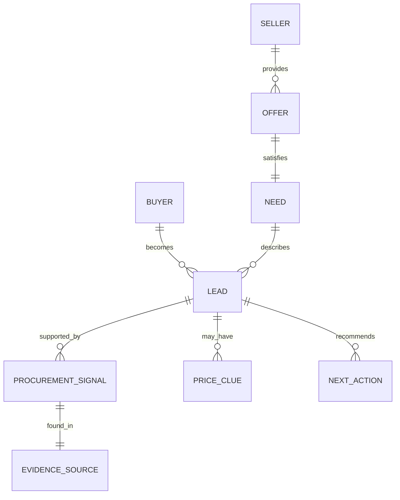

# Space Procurement Signal Radar - Business Ontology

## Purpose

The ontology defines what the product believes the world contains.

Without this, the project is just search results. With it, the agent can reason about buyers, sellers, needs, signals, urgency, and price discovery.

## Core Entities

| Entity | Definition | Example |
| --- | --- | --- |
| Buyer | Organization that may need a niche space-related product/service | Smallsat startup, payload company, deployable hardware company |
| Seller | Organization that can provide the niche product/service | TVAC lab, environmental test facility, cleanroom provider |
| Need | Specific thing the buyer may need | Thermal vacuum testing |
| Procurement Signal | Public evidence suggesting possible need | Launch timeline, qualification campaign, tender, funding |
| Urgency Trigger | Time-based reason the need may matter soon | Mission announcement, prototype, delivery date |
| Price/Budget Clue | Evidence about affordability or budget | Grant amount, tender value, contract award, comparable lab pricing |
| Evidence Source | URL or document supporting a claim | Company news page, ESA tender, DLR grant |
| Lead | Buyer + likely need + evidence + score | Company row in the output |
| Confidence | How strongly evidence supports the lead | Low, Medium, High |
| Next Action | Human action after reviewing lead | Verify, find contact, draft email, park |

## Buyer Ontology

| Buyer Type | Signal Language | Why It May Need TVAC |
| --- | --- | --- |
| Smallsat manufacturer | satellite, platform, bus, constellation | Whole spacecraft qualification |
| CubeSat team | CubeSat, nanosatellite, university mission | Small mission qualification before launch |
| Payload company | payload, sensor, optical, infrared, RF | Payload environmental testing |
| Propulsion company | thruster, propulsion, electric propulsion | Vacuum-relevant hardware testing |
| Deployable hardware company | antenna, solar array, deployable, actuator | Shock/vibration/thermal qualification |
| Avionics company | flight computer, electronics, harnessing | Thermal/vibration/radiation qualification |
| Research institute | project, consortium, demonstrator | Ecosystem clue, partner clue, or procurement source |

## Seller Ontology

| Seller Type | Capability | What They Sell |
| --- | --- | --- |
| Environmental test lab | TVAC, vibration, shock | Qualification campaigns |
| Cleanroom provider | assembly, integration, contamination control | Assembly and integration support |
| Radiation test provider | radiation, rad-hard, SEE, TID | Radiation qualification |
| Component supplier | connectors, harnessing, materials | Flight/space-grade parts |
| Consulting/QA provider | ECSS, NASA, documentation | Compliance and qualification planning |

## Need Ontology

Primary need:

```text
Thermal vacuum testing
```

Related needs:

| Need | Keywords |
| --- | --- |
| Thermal vacuum testing | thermal vacuum, TVAC, thermovakuum, vacuum chamber |
| Vibration testing | vibration, vibrationsprüfung, shaker, random vibration |
| Shock testing | shock, pyroshock, mechanical shock |
| Radiation testing | radiation, rad-hard, TID, SEE |
| Cleanroom assembly | cleanroom, ISO class, contamination control |
| Harnessing/connectors | harness, cable assembly, space-grade connectors |

## Signal Ontology

| Signal Class | Meaning | Keywords |
| --- | --- | --- |
| Need fit | Company builds relevant hardware | satellite, CubeSat, payload, propulsion, deployable |
| Urgency | Something creates time pressure | launch, mission, selected, awarded, delivery, prototype |
| Dependency | Public text mentions qualification/test dependency | TVAC, ECSS, vibration, shock, cleanroom, radiation |
| Small-company fit | Likely does not own all infrastructure | startup, SME, spin-off, ESA BIC, founded |
| Budget clue | Money or procurement trail exists | tender, award, grant, funding, ESA, DLR, EUR |
| Contactability | Seller can act on the lead | contact, procurement, supplier, partner, imprint |

## Score Ontology

| Score Band | Meaning | Action |
| --- | --- | --- |
| 80-100 | Strong lead | Verify source, find technical/procurement contact |
| 60-79 | Good lead | Research one level deeper |
| 40-59 | Weak but interesting | Keep if evidence is fresh |
| 0-39 | Not a lead yet | Use only as source/context |

## Evidence Rules

The agent should never invent.

| Rule | Good Behavior |
| --- | --- |
| Source-backed claims only | Every lead has a URL |
| Proxy price honesty | Say "proxy only" when no direct price exists |
| Research institutes are not automatic buyers | Mark them as ecosystem anchors if needed |
| Recent evidence beats generic evidence | Prioritize mission/tender/funding/news pages |
| Low confidence is acceptable | Better low-confidence honesty than fake precision |

## Business Object Model



## Product Value Proposition

For testing labs and niche aerospace suppliers:

```text
Find procurement pressure before it becomes obvious.
```

For founders/BD:

```text
Turn scattered public web signals into a ranked action list.
```

For hackathon judges:

```text
The agent pays for live web discovery, transforms messy public data into structured procurement intelligence, and pushes it into an operational workflow.
```

