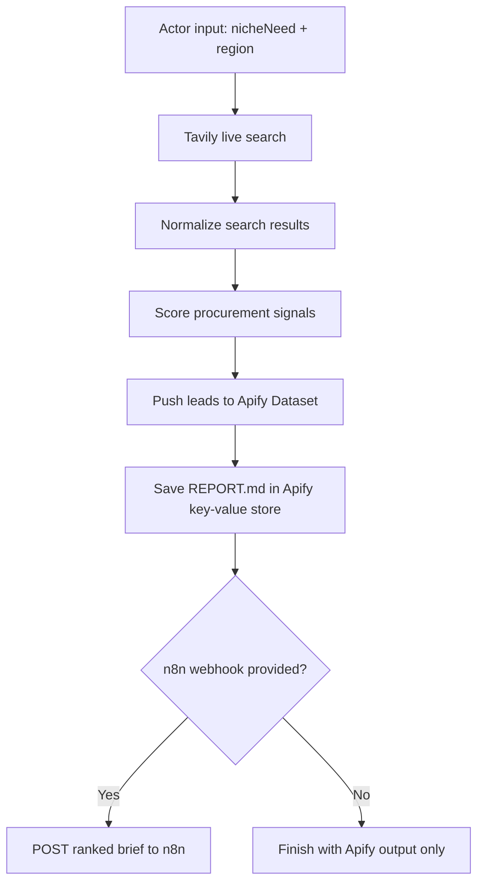

# Space Procurement Signal Radar - Every Step Runbook

## What "Useful" Means

I am treating "FDA" as **from-day-one actionable**.

Useful does not mean "the agent found many links." Useful means:

```text
A seller can look at the output and decide who to research/contact first, why now, and what evidence supports the lead.
```

## Final Hackathon Shape

Project:

```text
Space Procurement Signal Radar
```

One-line product:

```text
An Apify Actor that finds DACH space-tech companies with likely procurement pressure for thermal vacuum testing, scores them, and sends the ranked brief to Apify Dataset and optionally n8n/Notion.
```

## What You Are Building

### Core Workflow



### Tools

| Tool | What It Does | Why It Matters |
| --- | --- | --- |
| Apify Actor | Packages the workflow as a runnable product | Satisfies hackathon requirement and creates a public demo artifact |
| Tavily | Finds live web results for companies, tenders, ecosystem clues | Gives live data quickly without building a scraper first |
| n8n | Receives results and routes them to Notion/Sheets/email | Turns a report into a repeatable workflow |
| Notion | Human-facing database/dashboard | Makes the output useful for reviewing leads |
| Dockerfile | Lets Apify build the Actor | Required for reliable cloud execution |
| JSON input schema | Creates the Apify Console form | Makes the Actor beginner-friendly |

## Step 1 - Keep The Scope Narrow

Do not start with "space procurement" in general.

Start with:

```text
Thermal vacuum testing services for small satellite / CubeSat / payload / propulsion / deployable-hardware companies in Germany/DACH.
```

Why:

- Specific buyer pain.
- Specific seller.
- Searchable signals.
- Easy to explain in 2 minutes.
- Real price/budget proxies exist through tenders, awards, facilities, and grants.

## Step 2 - Use The Existing Actor Scaffold

Folder:

```text
actor-space-procurement-radar/
```

Important files:

| File | Purpose |
| --- | --- |
| `src/main.js` | Main actor logic |
| `.actor/INPUT_SCHEMA.json` | Defines fields shown in Apify Console |
| `.actor/actor.json` | Actor metadata/build config |
| `Dockerfile` | How Apify builds the Actor |
| `.actor/README.md` | Actor page description |
| `package.json` | Node dependencies and start command |

## Step 3 - First Run Without Credentials

Use dry run first.

Input:

```json
{
  "nicheNeed": "thermal vacuum testing",
  "region": "Germany DACH",
  "dryRun": true
}
```

What to check:

| Check | Expected |
| --- | --- |
| Actor run finishes | Yes |
| Dataset contains rows | Yes |
| Each row has a score | Yes |
| Key-value store has `REPORT.md` | Yes |
| Output says this is fixture/demo data | Yes |

This proves the product shape works before live APIs.

## Step 4 - Get Tavily Working

Tavily is the live discovery layer.

Add this as an Apify secret/environment variable:

```text
TAVILY_API_KEY=tvly-your-key
```

Run:

```json
{
  "nicheNeed": "thermal vacuum testing",
  "region": "Germany DACH",
  "maxResultsPerQuery": 5,
  "maxLeads": 10,
  "searchDepth": "basic",
  "dryRun": false
}
```

Use `basic` search depth for demo cost control.

What to check:

| Check | Good Sign |
| --- | --- |
| Search results returned | Dataset has real source URLs |
| Scores vary | The scoring model is doing some work |
| Some low scores appear | The system is not pretending every result is a lead |
| Price clues are honest | It says "proxy only" when needed |

## Step 5 - Add n8n

In n8n create:

```text
Webhook -> Respond to Webhook
```

Webhook settings:

```text
HTTP Method: POST
Path: space-procurement-radar
```

Copy the test webhook URL into the Actor input:

```json
{
  "n8nWebhookUrl": "https://your-n8n-url/webhook-test/space-procurement-radar"
}
```

Run the Actor.

What to check in n8n:

| Check | Expected |
| --- | --- |
| Webhook receives JSON | Yes |
| Payload has `leads` | Yes |
| Payload has `ledger` | Yes |
| Top lead has score/evidence/source URL | Yes |

## Step 6 - Add Notion Only After n8n Works

Do not begin with Notion.

First prove:

```text
Actor -> n8n webhook
```

Then add Notion:

```text
Webhook -> Split/Loop leads -> Notion Create Database Page
```

Minimum viable Notion fields:

| Field | Source |
| --- | --- |
| Company | `companyOrSource` |
| Region | `region` |
| Likely Need | `likelyNeed` |
| Score | `score` |
| Confidence | `confidence` |
| Evidence | `evidence` |
| Evidence URL | `sourceUrl` |
| Seller Angle | `sellerAngle` |
| Price Clue | `priceBudgetClue` |

If looping is annoying, send only the top lead first. That is okay for a hackathon demo.

## Step 7 - Make The Output Useful

Each lead must answer:

```text
Who is this?
What might they need?
Why might they need it soon?
What source says so?
Is there a budget/price clue?
What should a seller do next?
```

If a row does not answer those questions, it is not useful yet.

## Step 8 - Improve The Scoring Model

Current score:

| Category | Points |
| --- | ---: |
| Need fit | 25 |
| Urgency | 20 |
| Dependency | 20 |
| Small-company fit | 15 |
| Price/budget clue | 10 |
| Contactability | 10 |

Useful improvement:

```text
Add negative scoring for giant incumbents, universities, pure research pages, and generic media articles.
```

Examples:

| Result Type | Action |
| --- | --- |
| Space startup | Keep |
| Small hardware supplier | Keep |
| Research institute | Keep as ecosystem source, not lead |
| Big prime contractor | Lower score |
| Tender page | Keep as price proxy |
| Blog/media article | Use only if it points to source evidence |

## Step 9 - Demo Script

Say:

```text
Most sales tools find generic leads. This agent finds procurement pressure.

I focused on DACH space-tech because small mission teams often depend on niche external services like thermal vacuum testing.

The Actor takes a specific thing to sell, uses Tavily for live discovery, scores public signals for need/urgency/dependency/budget clues, writes ranked leads to Apify Dataset, and can push the result into n8n for Notion or CRM workflows.
```

## Step 10 - What To Show

Show in this order:

1. Apify Actor input form.
2. Run with `dryRun=true` if live API is risky.
3. Dataset rows.
4. `REPORT.md`.
5. n8n webhook execution.
6. Notion page/database if connected.

## Step 11 - Judge-Friendly Claim

```text
This is not just scraping. It is a procurement decision-intelligence workflow: live discovery, evidence scoring, price proxy detection, and workflow delivery.
```

## Step 12 - After The Hackathon

Best next upgrades:

| Upgrade | Why |
| --- | --- |
| Add Apify Website Content Crawler | Deeper evidence from company pages |
| Add Notion write automation | Makes it operational |
| Add seller/lab map | Turns leads into a marketplace view |
| Add negative scoring | Reduces noise |
| Add source freshness | Prioritizes recent signals |
| Add contact extraction | Moves closer to sales workflow |

