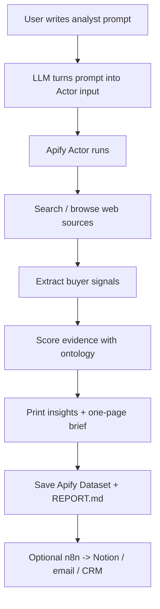
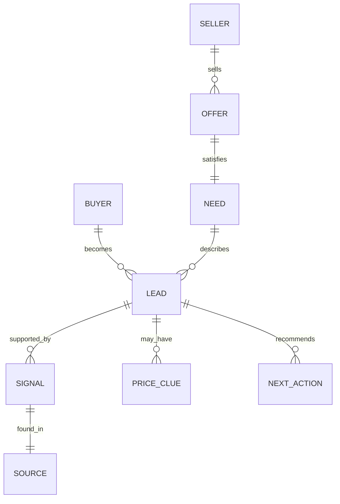

# Space Procurement Signal Radar

## Prompt In -> Evidence Out

**Hackathon concept:** a forward deployed analyst Actor for niche B2B procurement discovery.

```text
User prompt -> web/search discovery -> score evidence -> print insights -> save report
```

---

# 1. The Problem

As a seller of a niche product, the hard question is not:

```text
Who exists in this market?
```

The useful question is:

```text
Who has procurement pressure right now, and what evidence proves it?
```

For a seller in a concentrated buyer market, the goal is to identify the few buyers that matter first.

Example seller:

```text
Thermal vacuum testing provider
```

Example domain:

```text
DACH space-tech companies
```

---

# 2. The User Prompt

The user gives the Actor a plain-language analyst task.

```text
Find 1-5 DACH space-tech companies likely to need thermal vacuum testing soon.
For each company, report the score, evidence, source link, contact info if available,
and a short engagement email.
```

Minimum inputs:

| Input | Example |
| --- | --- |
| Product X | thermal vacuum testing |
| Domain | DACH space-tech |
| Region | Germany, Austria, Switzerland |
| Company count | 1-5 |
| Output | ranked brief + email template |

---

# 3. Simple System Flow



**Core tech:** LLM + Apify Actor  
**Nice to have:** Tavily for search, n8n for workflow handoff

---

# 4. Business Ontology

The Actor is useful because it has a small ontology.



Key idea:

```text
Do not output "companies."
Output "leads with evidence and next action."
```

---

# 5. Score Evidence

The Actor scores each source 0-100.

| Category | Points | What It Means |
| --- | ---: | --- |
| Need fit | 25 | Company builds relevant hardware |
| Urgency | 20 | Launch, contract, prototype, tender, delivery |
| Dependency | 20 | TVAC, qualification, vibration, ECSS, cleanroom |
| Small-company fit | 15 | Startup/SME likely uses external suppliers |
| Price clue | 10 | Tender, award, grant, funding, budget proxy |
| Contactability | 10 | Contact, supplier page, imprint, email |

Small code sketch:

```js
const score = signals
  .filter((signal) => signal.hit)
  .reduce((sum, signal) => sum + signal.points, 0);
```

---

# 6. Actor Input

The LLM can help the user produce this input.

```json
{
  "analystPrompt": "Find 1-5 DACH space-tech companies likely to need thermal vacuum testing soon. Report score, evidence, link, contact info, and an engagement email.",
  "nicheNeed": "thermal vacuum testing",
  "domain": "space-tech",
  "region": "Germany DACH",
  "maxLeads": 5,
  "dryRun": false
}
```

Beginner version:

```json
{
  "analystPrompt": "Find DACH space-tech companies likely to need thermal vacuum testing soon.",
  "nicheNeed": "thermal vacuum testing",
  "region": "Germany DACH",
  "dryRun": true
}
```

---

# 7. Actor Logic

Tiny theoretical code shape:

```js
const input = await Actor.getInput();

const sources = await searchWeb({
  prompt: input.analystPrompt,
  product: input.nicheNeed,
  region: input.region,
});

const leads = sources
  .map((source) => scoreEvidence(source, ontology))
  .sort((a, b) => b.score - a.score)
  .slice(0, input.maxLeads || 5);

await Actor.pushData(leads);
await Actor.setValue("REPORT.md", renderBrief(leads));
```

The output should be readable even before n8n or Notion exists.

---

# 8. Optional Search / Browse Layer

Two options:

| Option | Role | Difficulty |
| --- | --- | --- |
| Tavily | Search API for discovery | Easy |
| Apify Website Content Crawler | Deeper page extraction | Medium |

Tavily-style call:

```js
const response = await fetch("https://api.tavily.com/search", {
  method: "POST",
  headers: {
    "Authorization": `Bearer ${TAVILY_API_KEY}`,
    "Content-Type": "application/json"
  },
  body: JSON.stringify({
    query: `${product} ${domain} ${region} procurement`,
    search_depth: "basic",
    max_results: 5
  })
});
```

---

# 9. One-Page Brief Output

For each company, print:

| Field | Meaning |
| --- | --- |
| Company | Name of likely buyer |
| Region | Germany / Austria / Switzerland |
| Link | Source URL |
| About | 2-3 sentence paragraph |
| Score | 0-100 |
| Evidence | Why the lead is plausible |
| Contact | Email/contact page/imprint if found |
| Next action | Verify, find technical buyer, draft email |
| Email template | Short first-touch message |

The brief should fit on one page for 1-5 companies.

---

# 10. Example Brief

## Lead 1: Example Space Hardware Company

| Field | Value |
| --- | --- |
| Region | Germany |
| Link | `https://example.com/news/mission-update` |
| Score | 75 |
| About | Builds satellite deployable hardware for small spacecraft missions. Recent mission/news language suggests qualification and delivery pressure. |
| Evidence | Mentions qualification, mission integration, and space hardware testing. |
| Contact | Contact page or imprint found |
| Next action | Verify whether they outsource TVAC or vibration qualification |

Email:

```text
Subject: Thermal vacuum test capacity for upcoming qualification work

Hi {{Name}},

I saw {{company}} is working on {{specific mission/product}}.
If you are planning qualification or acceptance testing, we may be able to help with
thermal vacuum and environmental test capacity for space hardware.

Would it be useful to compare your upcoming test window against our availability?

Best,
{{Seller}}
```

---

# 11. n8n Handoff

n8n is not needed for the first demo. It is the workflow upgrade.

```mermaid
sequenceDiagram
    participant Actor as Apify Actor
    participant N8N as n8n Webhook
    participant Notion as Notion/CRM
    participant Seller as Seller

    Actor->>N8N: POST ranked leads + brief
    N8N->>Notion: Create lead rows
    N8N->>Seller: Send summary / draft outreach
    Seller->>Notion: Review and update status
```

Minimum n8n workflow:

```text
Webhook -> Set -> Notion/Sheets
```

---

# 12. Demo Script

```text
This Actor acts like a forward deployed analyst for a niche seller.

The user gives it a plain-language prompt: find 1-5 companies in a domain and region
that may need Product X.

The Actor searches/browses public web evidence, scores each lead with a small
procurement ontology, then prints a one-page brief with company links, evidence,
contact information if available, and a suggested engagement email.

Apify provides the runnable Actor and data store.
Tavily can provide live search.
n8n can push the result into Notion or a sales workflow.
```

---

# 13. What Makes It Useful

The output is not:

```text
A generic scraped list.
```

The output is:

```text
A ranked action list for a seller deciding where to spend attention today.
```

Success criteria:

- 1-5 companies, not 100 vague links.
- Each lead has evidence.
- Scores are explainable.
- Budget/price clues are honest.
- The brief suggests the next human action.

