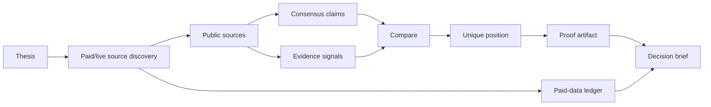

# Zero-to-One Singularity Radar - Hackathon Context

Date: 2026-06-20
Event: Agents that pay hackathon, juggleHUB Berlin
Pivot note: This version avoids job search, recruiting, CV screening, and interview preparation. It uses personal/project positioning only as strategic source material.

## 1. Core Idea

Build an agent that helps a person, founder, researcher, or project find the narrow position only they can think from, then validate whether that position is legible, credible, and worth building into a zero-to-one proof artifact.

The agent does not ask, "How do I fit a job?"

It asks:

> "What is the non-consensus position I can actually stand behind, and what public evidence would make it credible enough to build?"

This carries over the personal-branding insight:

> The strongest brand is not built by simply going against the crowd, but by finding the position only you can think from and stand behind with conviction.

In product terms, this becomes:

> A paid-web agent for discovering strategic uniqueness: it compares a thesis against live public evidence, identifies where consensus is crowded, finds overlooked angles, and recommends the first proof artifact that could make the thesis real.

## 2. What "Singularity" Means Here

Use "singularity" carefully. For this hackathon, it should not mean grandiose AGI claims.

It means **strategic convergence**:

- Your lived perspective
- A real market or institutional bottleneck
- A non-consensus thesis
- A public evidence base
- A proof artifact that makes the thesis legible

The "singularity point" is the place where those converge into a position that is:

- Unmistakably yours
- Legible to others
- Credible under scrutiny
- Compatible with the arena you want to operate in
- Distinct enough to create zero-to-one value

## 3. One-Sentence Demo

"Give the agent a thesis and a domain; it pays for live web evidence, maps the consensus, finds the overlooked angle, and recommends the smallest proof artifact that could turn the thesis into something real."

## 4. Strong Hackathon Name Options

- **Zero-to-One Radar**
- **Singularity Radar**
- **Thesis-to-Proof Agent**
- **Non-Consensus Proof Engine**
- **Conviction Map**
- **Original Position Finder**

Recommendation: use **Zero-to-One Radar** in the room. It is more legible than "Singularity Radar" and less likely to sound abstract.

## 5. Product Thesis

Most AI tools optimize for polish:

- Better copy
- Better pitch decks
- Better resumes
- Better summaries

Zero-to-One Radar optimizes for strategic originality:

- What is everyone already saying?
- What is the overlooked contradiction?
- What can this user uniquely claim?
- What would prove it?
- What should they build first?

The key value is not self-expression alone. It is **conviction with evidence**.

## 6. Apify/Paid-Web Fit

The agent has a reason to pay for data because it must distinguish:

- Consensus from non-consensus
- Real demand from self-narrative
- Public evidence from vague intuition
- Saturated markets from overlooked openings

Paid/live data calls can retrieve:

- Search results around the thesis
- Public articles and blogs
- Company/product pages
- Marketplace pages
- Public case studies
- Public founder/community/event pages
- Actor Store pages and pricing pages
- Public reports and documentation

The agent records a ledger:

- Which Actor was used
- Why it was used
- What input was sent
- What output was returned
- Cost proxy
- Signal value

## 7. Safe Scope

Allowed:

- Public strategic research
- Market/category mapping
- Project thesis validation
- Founder/product positioning
- Public source synthesis
- Non-sensitive institutional bottlenecks
- Public evidence-backed proof planning

Avoid:

- Job search and recruiting
- Personal profiling of third parties
- Contact harvesting
- Background checks
- Financial advice
- Sensitive defense claims
- Surveillance framing
- Scraping private accounts or credential exports

## 8. Demo Input

Use one thesis, not a CV.

Example thesis:

> "The next valuable agent is not just a browser. It is an economic actor that can decide when live data is worth paying for, explain why, and preserve a ledger of that decision."

Alternative thesis:

> "The highest-leverage AI tools will not automate judgment. They will make judgment auditable by separating claims, evidence, assumptions, and next actions."

Alternative thesis:

> "A strong personal or founder brand is not contrarian performance. It is the discovery of the narrow, evidence-backed position only that person or project can occupy."

## 9. Demo Question

Recommended:

> "Is there public evidence that builders need agents which evaluate, buy, and ledger paid web data instead of blindly scraping?"

The output should answer:

- What is the visible consensus?
- What is the overlooked angle?
- What sources support it?
- What evidence is weak or missing?
- What is the first proof artifact?

## 10. OSINT Workflow

Use OSINT as public-source thesis validation.

### Find

Discover the public surface around the thesis:

- Search results
- Actor marketplace pages
- Docs
- Public articles
- Event pages
- Product pages

### Fix

Constrain sources:

- Official or primary sources first
- Recent public pages
- Marketplace metadata
- Avoid personal data
- Exclude low-quality or unrelated sources

### Track

Record:

- Actor
- Input
- Source URL
- Retrieval time
- Cost proxy
- Signal value

### Target

Identify:

- Consensus claims
- Saturated phrases
- Repeated needs
- Missing products
- Contradictions
- Underbuilt proof opportunities

### Engage

Generate the proof artifact plan:

- What to build
- What source evidence it uses
- What it proves
- What it does not claim
- What a demo would show

### Assess

Evaluate:

- Is the thesis distinctive?
- Is it credible?
- Is the next artifact small enough to build?
- Does live data support or weaken the idea?

## 11. Minimal Ontology

Core entities:

- `Thesis`: the non-consensus claim being tested
- `Arena`: the domain where the thesis must be legible
- `Source`: public URL retrieved through Actor or crawl
- `ConsensusClaim`: what many sources already say
- `Contradiction`: tension, gap, or underexplored angle
- `UniquePosition`: the narrow position the user/project can stand behind
- `EvidenceSignal`: public evidence supporting or weakening the thesis
- `ProofArtifact`: smallest buildable artifact that makes the position credible
- `LedgerEntry`: paid/live data call and its value
- `DecisionBrief`: final report

## 12. Minimal SQL Model

```sql
theses(id, thesis_text, arena, created_at)
actor_runs(id, actor, input_json, cost_usd, status, started_at, ended_at)
sources(id, thesis_id, run_id, url, title, retrieved_at, credibility, freshness)
consensus_claims(id, thesis_id, source_id, claim, frequency_hint)
contradictions(id, thesis_id, description, source_id, confidence)
evidence_signals(id, thesis_id, source_id, signal_text, supports_thesis, confidence)
unique_positions(id, thesis_id, position_text, legibility_score, credibility_score, originality_score)
proof_artifacts(id, thesis_id, artifact_name, artifact_type, spec, priority, proof_claim)
ledger_entries(id, run_id, actor, reason, input_summary, output_summary, cost_proxy, signal_value)
```

## 13. MVP Demo Flow

1. User enters thesis and arena.
2. Agent runs a search Actor for the thesis domain.
3. Agent crawls 2-5 public pages.
4. Agent extracts consensus claims.
5. Agent extracts contradictions and overlooked angles.
6. Agent proposes a unique position.
7. Agent recommends one proof artifact.
8. Agent prints the paid-data ledger.
9. Agent generates a Markdown decision brief.

## 14. Recommended Hackathon Demo

### Demo Thesis

> "Agents that pay need a buyer's conscience: a way to decide which data is worth paying for, why it is worth paying for, and how much signal it returned."

### Arena

Paid web data and Apify Actors.

### Sources

- Apify Store category pages
- Actor pages for Google Search Results Scraper and Website Content Crawler
- Apify pricing model docs
- Event description
- Public pages about AI agents and paid web data

### Output

The report should produce:

- Consensus: agents need tools and live data
- Gap: fewer tools help agents decide whether a data purchase was worth it
- Unique position: "data-buying judgment layer"
- Proof artifact: a ledger-first agent that compares two Actor choices and explains which one had better signal value
- Next build: CLI or small web app where a user enters a question and sees source choice, retrieval ledger, and proof recommendation

## 15. Sample Report Headline

**Zero-to-One Finding**

The market is crowded around "agents can access tools." The underbuilt position is "agents need procurement judgment." A paid-web agent should not merely call an Actor; it should decide why that Actor is worth paying for, preserve the ledger, and evaluate whether the returned evidence changed the decision.

## 16. Proof Artifact Recommendation

Build:

**Paid Data Decision Ledger**

What it does:

- Takes a strategic question
- Searches for possible data sources
- Selects one or two Apify Actors
- Retrieves evidence
- Assigns each source a signal-value score
- Produces a short proof brief
- Shows the ledger

What it proves:

- The agent can make paid-data choices, not just scrape.
- The output is auditable.
- The user's thesis is tested against public evidence.
- The next zero-to-one artifact is grounded in reality.

## 17. Pitch

"Most AI tools help people sound clearer. Zero-to-One Radar helps them think from a position that is actually theirs. It starts with a thesis, buys live web evidence through Apify, maps the consensus, identifies the overlooked angle, and recommends the smallest proof artifact that would make the thesis credible. The output is not just a narrative. It includes a ledger showing what the agent paid for, why, and what signal it got back."

## 18. What To Build Today

Build the chained Actor MVP:

- Python CLI
- Apify API calls
- SQLite or DuckDB
- Markdown report
- Ledger table
- Mermaid diagram

Do not build a broad personal-branding app. The narrow prototype is:

> Thesis -> live evidence -> consensus map -> unique position -> proof artifact -> paid-data ledger

## 19. Mermaid Seed



## 20. What I Need From You

To keep the demo sharp, provide:

1. The exact thesis you want tested.
2. The arena/domain where it should be legible.
3. Whether the proof artifact should be for a founder, researcher, builder, or institution.
4. Apify API token or confirmation you will run Actor calls manually.
5. Paid-data budget for the demo.

