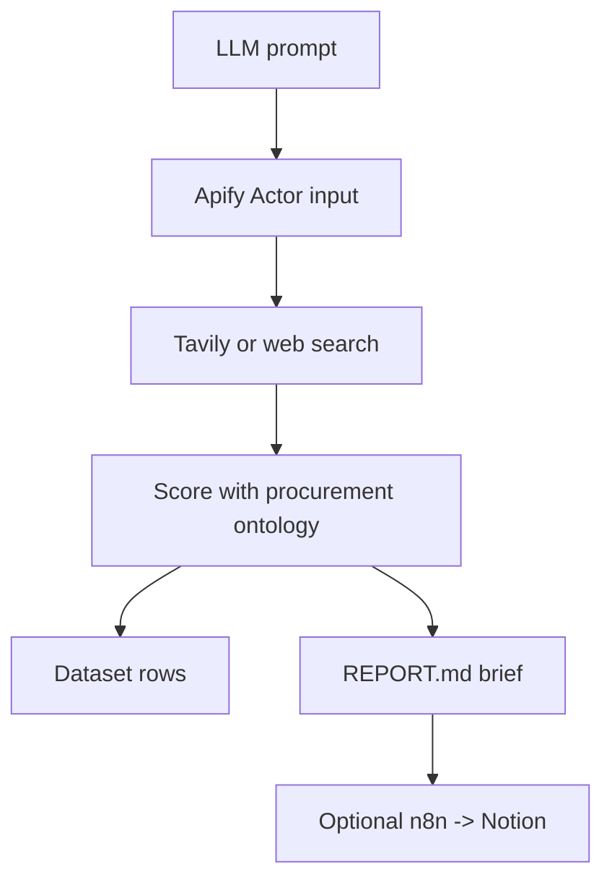

# Space Procurement Signal Radar - 5 Slide Live Pitch

---

# 1. Prompt In -> Evidence Out

```text
User prompt -> web/search discovery -> score evidence -> print insights -> save report
```

I am building an Apify Actor that acts like a forward deployed analyst for a niche seller.

Example prompt:

```text
Find 1-5 DACH space-tech companies likely to need thermal vacuum testing soon.
```

---

# 2. Why This Is Useful

As a seller in a concentrated buyer market, I do not need 100 generic companies.

I need:

```text
Who should I investigate first?
Why now?
What evidence supports it?
What is the next action?
```

The output is a ranked action list, not a scraped list.

---

# 3. How It Works



Core:

```text
LLM + Apify Actor
```

Nice to have:

```text
Tavily + n8n
```

---

# 4. Scoring Ontology

| Signal | Points |
| --- | ---: |
| Need fit | 25 |
| Urgency | 20 |
| Dependency | 20 |
| Small-company fit | 15 |
| Price/budget clue | 10 |
| Contactability | 10 |

Tiny code:

```js
const leads = sources
  .map((source) => scoreEvidence(source, ontology))
  .sort((a, b) => b.score - a.score)
  .slice(0, 5);
```

---

# 5. One-Page Brief

For each company:

```text
Company
Region
Link
About paragraph
Score
Evidence
Contact info if found
Next action
Email template
```

Close:

```text
This is procurement decision intelligence:
live discovery, evidence scoring, and a one-page brief a seller can act on.
```

